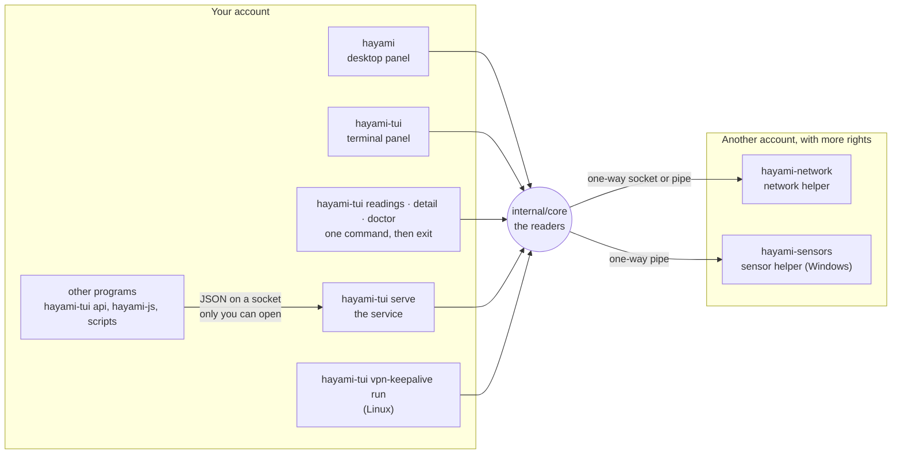

# How hayami runs

hayami is one program built twice, `hayami` and `hayami-tui`, and run in
several ways: as a window, as a terminal pane, as one command that prints and
exits, as a service other programs read, and as helpers that do what the
panel itself may not. This document is the map of those ways: what each one
is, what starts it, which account it runs as, and what it talks to.

How the code is laid out, the rules a change is held to and where an addition
goes are in [docs/architecture.md](docs/architecture.md). What each of the
ways below defends, and against whom, is in
[docs/threat-model.md](docs/threat-model.md).

## The picture

Every box on the left reads the machine the same way: through
`internal/core`, as the person, in its own process. None of them reads
another's readings, except a program that asks the service. The two boxes on
the right are the only parts of hayami that run with rights the person does
not have; each is installed only when asked for, and runs only while a panel
or the service reads it.

## The ways to run it

| Way | Command | Runs as | Started by | Stops |
|---|---|---|---|---|
| The desktop panel | `hayami` | the person | the login session (autostart), or by hand | Quit from its right-click menu |
| Its preferences | `hayami --preferences[=page]` | the person | the panel's menu, or by hand | closing the window |
| The terminal panel | `hayami-tui [--sections …] [--arrangement …]` | the person | a terminal, a multiplexer pane | `q`, Esc or Ctrl-C |
| One frame | `hayami-tui --once` | the person | a prompt or a status line | after one frame |
| One command | `hayami-tui readings`, `detail`, `doctor`, `arrangements` | the person | a script, a person | after printing |
| The service | `hayami-tui serve` | the person | its socket's first connection (systemd, Windows, launchd), or by hand | five minutes with nobody reading, when started by its socket |
| The service's client | `hayami-tui api …` | the person | a script, a person, CI's end-to-end run | after printing; `watch` when interrupted |
| The network helper | `hayami-network` | a dynamic user with three capabilities (Linux); Local Service (Windows) | its socket or service, when a panel opens the list | fifteen seconds after nobody reads it |
| The sensor helper | `hayami-sensors` (Windows) | LocalSystem | its service, when a panel reads the temperature | fifteen seconds after nobody reads it |
| The VPN keepalive | `hayami-tui vpn-keepalive run` (Linux) | the person, no added right | the login session (systemd user service) | stopping the service |
| The installer | `hayami-<version>-…-installer` | the person; one administrator prompt per opt-in page that needs it | the person | when done |

### The desktop panel

`cmd/hayami`, built with Fyne and cgo. A frameless glance window: the cards
stack, a detail drawer opens beside them, and the right-click menu holds
Preferences, Opacity and Quit. It reads the settings file and follows it as
it changes. On KDE Plasma it also loads small KWin scripts while it runs, and
writes a KWin rule when asked (`hayami window install`), because only the
compositor can remove a titlebar or place the drawer.

### The terminal panel

`cmd/hayami-tui`, built with Bubble Tea and without cgo, so it needs no
display library and runs over ssh. It draws the same sections from the same
descriptions as the window, in three arrangements: `stack`, `grid` and `row`.
`--sections` and `--arrangement` change one run and never the settings, so a
pane can show one reading in a row (`hayami-tui --sections usage
--arrangement row`) while the window shows everything. `--once` draws one
frame and exits, for a prompt or a status line.

### One command, then exit

`hayami-tui readings` prints every section's reading as JSON; `detail
<section>/<reading>` what is behind one reading (programs by processor, by
network use); `doctor` what each section found and why one is missing. They
need no display and no service: each reads the machine itself and exits.
This is how a reader is debugged.

### The service

`hayami-tui serve` gives the readings, their details and drills to other
programs of the same account, as JSON over a socket only that account can
open, under the contract in [api/openapi.yaml](api/openapi.yaml). A section
is read only while a client reads it. It serves facts, never the panel's
wording. [docs/api.md](docs/api.md) describes it.

| Platform | Set up as | Address |
|---|---|---|
| Linux | a systemd user socket and service, `hayami-api`, written by the installer's Service page on a first install | `$XDG_RUNTIME_DIR/hayami/api.sock` |
| Windows | a per-user service, `hayami-api`, of which Windows starts an instance as each account that signs in; its program is a copy in Program Files. Registering it asks for an administrator once | `\\.\pipe\hayami-api-<SID>` |
| macOS | a launchd agent, `io.ushineko.hayami.api`, set up with `hayami-tui api-service install` until the installer is built for macOS | `$TMPDIR/hayami/api.sock`, in the per-user directory only that account has |

It is on by default, and the installer's Service page removes it. Without a
service manager it runs by hand, in the foreground. `hayami-tui api` is the
reference client: `status` says whether it is installed and running, `get`
and `watch` read it, `check` holds every answer to the contract. The
JavaScript client, `hayami-js`, lives in
[herdr-mods](https://github.com/ushineko/herdr-mods), not here.

### The helpers

Three parts of a reading need what an unprivileged panel cannot have. Each
is its own service, installed only when asked for, and each is reached by a
panel or the service, not by the person.

- **The network helper**, `hayami-network`, gives the network by process.
  On Linux it is a systemd service started by its socket, running as an
  account systemd makes for the run with `CAP_BPF`, `CAP_NET_ADMIN` and
  `CAP_PERFMON`; it loads the eBPF counter in `internal/netcount` only while
  it runs. On Windows it runs as Local Service. Either way it writes process
  IDs and byte counts down a one-way socket or pipe that one account may
  open. Installed from the installer's Network page or `hayami-tui
  network-helper install`; on Linux the system asks for an administrator
  through polkit.
- **The sensor helper**, `hayami-sensors`, gives the processor's temperature
  on Windows. It runs as LocalSystem because PawnIO's driver serves only
  SYSTEM and administrators, loads one of two signed PawnIO modules pinned by
  hash, and writes the temperature down a one-way pipe. Installed from the
  installer's Sensors page or `hayami-tui sensor-helper install`.
  LibreHardwareMonitor's web server, where it is running, is read after it.
- **The VPN keepalive**, `hayami-vpn-keepalive`, keeps a chosen VPN working
  with no panel open, on Linux. It is a systemd user service running as the
  person with no added right, so it asks for no administrator. It acts only
  on a VPN switched on for it. Installed from the installer's VPN page or
  `hayami-tui vpn-keepalive install`.

A helper's program is a copy of `hayami-tui` where only an administrator can
change it, run with a subcommand; there is no third binary.

### What each way reads

Every way above reads through `internal/core` and `internal/usage`: devices
through [sanshoku](https://github.com/ushineko/sanshoku) (hidraw, BlueZ,
hwmon by label), the system's counters, the helpers' sockets and pipes, and
over the network only the usage providers' APIs and, when the Development
drawer's forges are switched on, GitHub's and a GitLab host's. The usage
cache (`~/.cache/claude-usage-widget` on Linux) is shared by every hayami
process and by the Python tools hayami replaces, so several readers make one
upstream request per freshness window.
